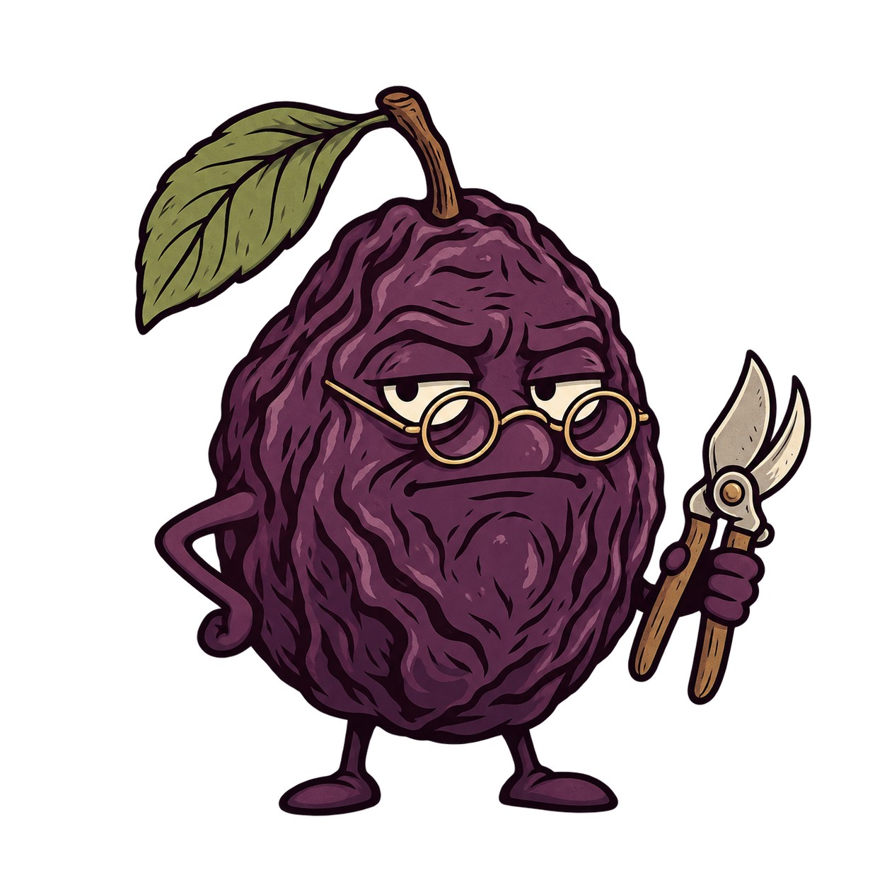

<p align="center">
  
</p>

<h1 align="center">Prune</h1>

<p align="center">
  <em>Keep what earns its place.</em><br>
  The feature ships. The framework you didn't need doesn't.
</p>

<p align="center">
  <a href="LICENSE"></a>
  
  
</p>

You asked for a bug fix. Your agent came back with a factory, a strategy interface, six renamed files, and a TODO to check whether the API exists.

Prune is the colleague who reads the code, finds the helper two files over, fixes the shared path, and runs the check. Then stops. A small, unimpressed fruit with a low tolerance for architectural shrubbery.

**A coding skill for readable, scoped, complete, verified work.** Born from [Ponytail](https://github.com/DietrichGebert/ponytail), grown out of [Scott's fork](https://github.com/swicken/ponytail). Same lazy senior dev instincts. More attention to what must keep working.

## Before / after

You ask for a date field in a plain HTML form. Your agent reaches for a calendar package, a wrapper component, a stylesheet, and a timezone committee.

With Prune:

```html
<label for="due">Due date</label>
<input id="due" name="due" type="date">
```

If you actually asked for a custom calendar, you still get one. **The ladder trims the how, not the ask.** Ordinary use of a built-in doesn't need a comment congratulating itself.

## The ladder

Read the request. Trace the code. Then stop at the first rung that holds:

```text
1. Does this need to exist?        → skip speculative work
2. Already in this codebase?       → reuse it; look before you write
3. Standard library does it?       → use it
4. Native platform covers it?      → use it
5. Installed dependency covers it? → use it
6. Can it collapse?                → only while it reads at a glance
7. Only then                      → the minimum complete implementation
```

A clear ten lines beats a cryptic one. Three copies of the same decision can earn an abstraction; three things that happen to look alike cannot. A smaller diff in the wrong place is still a bug.

Prune keeps trust-boundary validation, data-loss handling, security, accessibility, and every explicit requirement. Even in `ultra`. The shears have a safety catch.

## Numbers, including the awkward ones

We compared Prune with the untouched Ponytail fork at [`9223a3f`](https://github.com/swicken/prune/tree/9223a3f12f1a3eab377d0494bcbc9f544fa16b61), using identical adapter checks and two paired live coding trials on **29 September 2026**.

### Adapter checks: 2/16 → 16/16

| Same 16 targeted contracts | Ponytail | Prune |
|---|---:|---:|
| Passing checks | **2/16** | **16/16** |

These cover config preservation, malformed files, BOM handling, mode changes, Claude config overrides and subagent context, Pi status/error handling, and hook fallback rules. They deliberately target known regressions, with two positive controls; one check verifies rule presence. This is evidence that the selected fixes work, **not an overall reliability percentage**.

### Coding trials: a tie

Twelve tasks per run: reuse, sibling callers, real duplication, independent policies, behavior preservation, runtime compatibility, cleanup, regression checks, complete parsing, root-cause debugging, explanations, and deliberate debt.

| Pair | Skill | Functional passes | Wall time | Output tokens | Code lines¹ |
|---|---|---:|---:|---:|---:|
| 1 | Ponytail | 11/12 | 187.15 s | 8,212 | 92 |
| 1 | Prune | 11/12 | 160.11 s | 7,142 | 104 |
| 2 | Ponytail | 11/12 | 171.60 s | 7,439 | 105 |
| 2 | Prune | 11/12 | 145.89 s | 6,465 | 107 |

**22/24 each.** Prune recorded less wall time and fewer output tokens in both pairs, and wrote *more* lines. The coding score tied. The marketing department will have to cope.

¹ Nonblank code lines, including checks. Line count isn't the score. Output tokens aren't a cost estimate.

**The failure stays in the table:** every submission mishandled JavaScript grouping with `__proto__` as a key. Normal-key checks missed it; the hidden grader caught it. No generated submission was patched to improve its score.

Two pilots are a small sample. Tasks shared context within each run, the CLI-default model wasn't pinned, and wall time includes tool/service latency. These runs establish neither a general coding-quality advantage nor a stable speed advantage. The dedicated review/audit/debt skills weren't independently activated in the live trials.

[Full report and limitations](benchmarks/results/2026-09-29-prune.md) · [Raw scores and usage](benchmarks/results/2026-09-29/scores.json) · [Exact run archives](benchmarks/results/2026-09-29-prune.md#evidence-and-reproduction) · [Method and reproduction](benchmarks/README.md)

The inherited Ponytail charts remain in the repo as historical evidence. They aren't Prune results, so they aren't doing the selling here.

## What you get

| Skill | Job |
|---|---|
| **prune** | Write or fix the smallest readable, complete solution. Verify it. |
| **prune-review** | Review a diff or PR: security, data loss, duplication, and correctness first; unnecessary machinery next. |
| **prune-audit** | Walk the whole repo and rank what to delete, simplify, or de-duplicate by payoff. |
| **prune-debt** | Read marked compromises: the ceiling, and what would justify revisiting it. |
| **prune-help** | The reference card. Even the fruit has documentation. |

Review, audit, and debt inspection are read-only by default. Audit, debt, and help are one-shot. Publishing review comments requires an explicit request.

An actual compromise gets a marker:

```python
# prune: global lock; use per-account locks if contention limits throughput
```

A standard-library call doesn't. Simple code doesn't need invented debt.

## Install

The repo is **private while we test it**, so these instructions assume your GitHub account has access. `main` is Prune; the Ponytail baseline remains in Git history.

### Codex: skills

Ask Codex's skill installer:

```text
$skill-installer Install the five skills from swicken/prune on main:
skills/prune, skills/prune-review, skills/prune-audit,
skills/prune-debt, and skills/prune-help.
```

Then invoke one in a chat:

```text
$prune Fix the bug in this handler.
$prune-review Review the current diff.
$prune-audit Find what we can delete from this repo.
```

Direct skills provide the instructions. Session hooks and persistent mode tracking come with the [plugin adapter](docs/agent-portability.md). [Official Codex skill documentation](https://learn.chatgpt.com/docs/build-skills).

### Claude Code: plugin

With GitHub SSH access configured:

```bash
claude plugin marketplace add git@github.com:swicken/prune.git --scope user
claude plugin install prune@prune --scope user
```

Start a new session. The plugin defaults to `full`; use `/prune` to inspect the current mode, `/prune-review` for the diff, or `/prune-help` for the commands.

### Other agents

Pi, OpenCode, and Gemini CLI have adapters. Cursor, Windsurf, Cline, Copilot, and Kiro have project instruction files. For any agent that reads `AGENTS.md`, copy [the compact rules](AGENTS.md) into its instruction file.

[Which files go where, and what each adapter supports](docs/agent-portability.md). Instruction-only installs are always-on rules; they don't add session commands. Adapter checks aren't an end-to-end certification of every host.

## How sharp?

For command-capable adapters:

| Mode | Behavior |
|---|---|
| `/prune lite` | Build what's asked; mention a materially simpler alternative. |
| `/prune full` | Enforce the ladder. Default. |
| `/prune ultra` | Challenge speculative scope harder. For when the codebase has wronged you personally. |
| `/prune off` | Put the shears down. |

All modes preserve explicit requirements and safety checks. `ultra` doesn't mean “delete the acceptance criteria.”

`/prune default lite` saves a startup default without changing the live mode. Standalone “stop prune” or “normal mode” switches it off; quoting either phrase inside a request doesn't.

<details>
<summary>Configuration, if you insist</summary>

No config file is required. Startup defaults resolve in this order:

1. `PRUNE_DEFAULT_MODE`
2. `defaultMode` in the config file
3. `full`

```json
{ "defaultMode": "lite" }
```

Config path: `$XDG_CONFIG_HOME/prune/config.json`, otherwise `~/.config/prune/config.json`; `%APPDATA%/prune/config.json` on Windows. Prune uses its own config and state names. Existing Ponytail settings aren't migrated.

</details>

## What grew out of Ponytail

The ladder stayed. So did the bias toward boring code. Prune adds a few sharper questions:

- **Did you read the shared path?** Fix the cause and check sibling callers. Don't stack a second patch on a failed guess.
- **Does it still do everything requested?** Preserve outputs, errors, side effects, and public contracts. Clean up private code your change makes unused.
- **Does that API exist here?** Check the installed version and supported runtime before using it.
- **What proves it?** Leave one meaningful runnable check for non-trivial logic. A copied implementation isn't an independent expected result.
- **What actually ran?** Report verification and its limits. “Looks fine” isn't a test result.
- **Did you finish the explanation?** Requested reports get the detail they need. Prune governs what you build, not how few words you're allowed to use.

The adapters got attention too: config writes preserve unrelated fields and reject malformed files, Claude respects its config-directory override, Pi reports status and save errors correctly, and generated rule copies are checked for drift. No new runtime dependencies.

[The implementation diff](https://github.com/swicken/prune/pull/1) keeps the original baseline and the changes reviewable.

## Development

```bash
gh repo clone swicken/prune
cd prune
npm run check
npm test
python3 benchmarks/agentic/run.py --selftest
```

`AGENTS.md` is the source for compact project rules and the hook fallback. After editing it, run `node scripts/sync-rule-copies.js`. `npm run check` checks those copies and manifest versions. CI runs on Linux and Windows.

The live benchmark runner uses your Codex account and executes generated code. [Read the method before running it](benchmarks/README.md). Deterministic checks don't need live model calls.

## FAQ

**Is this a “write fewer lines” skill?**

No. Prune wrote more lines in both pilot pairs. The point is less unnecessary machinery and fewer surprises for the next reader.

**What if I really need the cache class?**

Then build it. Correctly. The class can stay; its imaginary future plugin system may have to find another garden.

**Will it fix every bug?**

It lost a fight with `__proto__` in both trials. Keep reviewing and testing.

**Why “Prune”?**

Keep the useful growth. Cut the rest. Also, apparently, a fruit with glasses.

## Credits & license

[Dietrich Gebert](https://github.com/DietrichGebert/ponytail) created Ponytail: the original concept, ladder, adapters, artwork, and historical benchmarks. [Scott Wicken](https://github.com/swicken) made the fork and Prune. The new mascot was generated for Prune; the original artwork and benchmark assets retain their provenance.

[MIT](LICENSE). Credit where it's due. Code where it's needed.
